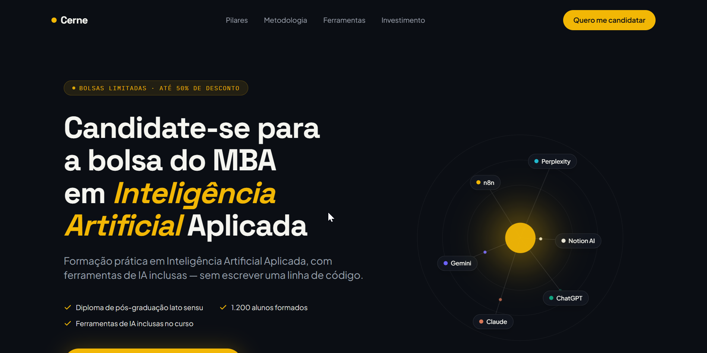

# Cerne — Landing page de MBA em IA Aplicada

Landing page de uma instituição de ensino **fictícia** ("Cerne"), feita como template: todo o conteúdo fica em um único arquivo (`src/content/site.ts`), e o formulário de candidatura salva os leads em um webhook configurável. Todos os nomes, dados, depoimentos e valores são ilustrativos e devem ser substituídos por informações reais antes de qualquer publicação.

**Demo ao vivo:** [projeto-page-institucional.vercel.app](https://projeto-page-institucional.vercel.app/)



Para entender o contexto e as decisões do projeto, veja [docs/CONTEXTO.md](docs/CONTEXTO.md). Para adaptar o template, veja [docs/PERSONALIZACAO.md](docs/PERSONALIZACAO.md).

## Tecnologias

- [Next.js](https://nextjs.org) 16.4 (App Router) + React 19
- TypeScript
- Tailwind CSS v4
- Framer Motion (animações)
- Lucide (ícones)
- Vitest (testes unitários)
- Fontes via `next/font/google`: Space Grotesk, Plus Jakarta Sans e IBM Plex Mono

## Requisitos

- Node.js **20.9 ou superior** (exigido pelo Next 16)

## Como rodar

```bash
cd cerne-mba
npm install
cp .env.example .env.local   # opcional em desenvolvimento
npm run dev
```

Abra [http://localhost:3000](http://localhost:3000).

## Scripts

| Comando           | Descrição                                   |
| ----------------- | ------------------------------------------- |
| `npm run dev`     | Servidor de desenvolvimento                 |
| `npm run build`   | Build de produção                           |
| `npm run start`   | Serve o build de produção                   |
| `npm run lint`    | Verifica o código com ESLint                |
| `npm test`        | Testes unitários (Vitest)                   |
| `npx tsc --noEmit`| Verificação de tipos                        |

## Variáveis de ambiente

Copie `.env.example` para `.env.local` e preencha:

| Variável                      | Obrigatória | Descrição |
| ----------------------------- | ----------- | --------- |
| `LEADS_WEBHOOK_URL`           | Para receber leads | URL que recebe as candidaturas por `POST` em JSON (Zapier, Make, n8n, Google Sheets via Apps Script, CRM). Sem ela, o formulário oferece o envio pelo WhatsApp. |
| `NEXT_PUBLIC_WHATSAPP_NUMBER` | Não         | Número do WhatsApp (código do país + DDD + número, só dígitos). Usado como fallback do formulário. |
| `LEADS_IP_SALT`               | Não         | Sal do hash do IP guardado no registro de consentimento. |

## Personalizar o conteúdo

Edite **somente** `src/content/site.ts`: nome da marca, textos da home, estatísticas (com fonte), ferramentas e valores, depoimentos, preço, FAQ e dados legais. Os componentes em `components/` leem esse arquivo e não precisam ser alterados.

As cores e fontes ficam no bloco `@theme` de `app/globals.css`.

## Estrutura

```
app/
  layout.tsx          metadados, fontes e HTML base
  page.tsx            composição das seções da home
  api/leads/          endpoint de candidaturas (validação, honeypot, limite de taxa, consentimento)
  termos/             Termos de Uso (modelo)
  privacidade/        Política de Privacidade (modelo)
  sitemap.ts, robots.ts, not-found.tsx
components/           uma seção por arquivo
src/content/site.ts   fonte única de conteúdo
src/lib/              validação de leads, limite de taxa, animações e easing
public/               imagens, ícone e og-image
```

As seções da home, na ordem em que aparecem: Hero, Pilares, Problema/Solução, Metodologia, Prova de dados, Ferramentas, Depoimentos, Investimento, FAQ, Formulário de candidatura e CTA final.

## Antes de publicar

- Substituir todos os dados de `src/content/site.ts` por informações reais, incluindo a fonte de cada estatística.
- Reconhecimento oficial do curso e do diploma, com o ato regulatório conforme o e-MEC.
- Remover depoimentos ilustrativos e usar apenas depoimentos reais, com autorização por escrito.
- Preencher os dados legais (`legal`): razão social, CNPJ, endereço e e-mail do encarregado.
- Revisão jurídica de **Termos de Uso** e **Política de Privacidade**, que são apenas modelos.
- Revisar o uso de marcas de terceiros (ChatGPT, Claude, Gemini etc.) e a afirmação de ferramentas incluídas.

## Licença

Distribuído sob a [licença MIT](LICENSE). Você pode usar, modificar e vender este código, desde que mantenha o aviso de copyright. O software é fornecido sem garantias.

A marca "Cerne" e todo o conteúdo de demonstração (textos, depoimentos, estatísticas e preços) são fictícios e não fazem parte da licença: substitua-os antes de usar em um projeto real.

## Deploy

O projeto é compatível com a Vercel. Ajuste `url` em `src/content/site.ts` para o domínio final e configure as variáveis de ambiente do projeto.

Os headers de segurança (CSP, `X-Frame-Options`, `Referrer-Policy` etc.) são definidos em `next.config.ts`.

## CI

O workflow em `.github/workflows/ci.yml` roda, a cada push e pull request, com Node 20: `npm ci`, lint, typecheck, testes e build.

## Notas para quem edita

Este projeto usa uma versão do Next.js com mudanças em relação a versões anteriores. Consulte a documentação incluída em `node_modules/next/dist/docs/` antes de alterar APIs, conforme descrito em [AGENTS.md](AGENTS.md).
